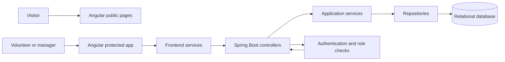

# Montauto Platform — Private-Code Case Study

> **Private project, public case study.** The production application's source repository is private. This page explains the product, architecture, workflows, and selected file/class names at a non-sensitive level. It contains no application source code, credentials, internal configuration, or real volunteer or organization data.

## Project summary

Montauto is a conservation and heritage platform that connects public information about preservation work with the people coordinating and carrying it out. It combines a public website with authenticated volunteer workflows and role-aware dashboards.

**My role:** Volunteer full-stack developer  
**Application:** Angular web client → Spring Boot API → relational database  
**Status:** Ongoing

## Why I built it

Conservation initiatives need to share information about heritage work and coordinate the volunteers who carry it out. Montauto brings public project information, task coordination, and progress tracking together in one platform.

## Who uses it

- **Visitors** read public information about conservation and heritage work.
- **Volunteers** access assigned tasks and report progress.
- **Administrators and presidents** use protected management and dashboard features according to their roles.

Access to protected operations is checked by the backend. This public overview describes roles by responsibility without publishing private account or permission details.

## How the work moves through the app

1. A visitor reads public pages about the mission, history, and volunteer programmes.
2. A volunteer signs in to access protected task features.
3. The Angular app requests task and profile information from the Spring Boot API.
4. The API checks authentication and the user's role before handling protected actions.
5. Authorized task updates are processed and saved to the relational database.
6. The app retrieves the latest state so volunteers and managers can follow progress.

Database changes are versioned with Flyway. H2 is used in local/testing scenarios, and MySQL configuration is supported.

## How the parts connect

The frontend and backend are separate layers. The client presents pages and sends requests; the backend validates protected actions, applies application rules, and persists approved changes.

## Selected files and classes

The map below shows representative names from the private project and each file's broad responsibility. It is not a copy of the repository tree, and it omits implementation details.

### Main folders

| Name | Purpose |
|---|---|
| `montauto.backend/` | Spring Boot API and backend security |
| `frontend/montauto-frontend/` | Angular application with server-side rendering support |
| `src/app/features/` | User-facing page and feature components |
| `src/app/services/` | Frontend services that connect features to API workflows |

### Backend classes

| File / class | Role |
|---|---|
| `AuthController.java` | Receives authentication-related requests. |
| `UserController.java` | Handles user-facing account operations. |
| `AdminController.java` | Provides management operations for authorized administrators. |
| `PresidentController.java` | Provides protected president-level dashboard operations. |
| `TaskController.java` | Receives task and progress requests. |
| `CampaignController.java` | Handles conservation campaign operations. |
| `VolunteerController.java` | Supports volunteer-related operations. |
| `VolunteerRequestController.java` | Handles requests to join or participate. |
| `AuthService.java` | Applies authentication workflow logic. |
| `TaskService.java` | Coordinates task and progress behavior. |
| `CampaignService.java` | Coordinates campaign behavior. |
| `VolunteerService.java` | Coordinates volunteer workflows. |
| `VolunteerRequestService.java` | Processes volunteer requests. |
| `UserServiceImpl.java` | Implements user-related application operations. |
| `SecurityConfig.java` | Sets up backend security and protected access. |
| `CustomUserDetailsService.java` | Loads user identity information for authentication. |

### Data and persistence classes

| File / class | Role |
|---|---|
| `User.java` | Represents a platform user. |
| `Role.java` | Represents an access role. |
| `Task.java` | Represents a volunteer task and its state. |
| `Campaign.java` | Represents a conservation campaign. |
| `VolunteerProfile.java` | Represents volunteer-specific profile information. |
| `VolunteerRequest.java` | Represents a request to participate. |
| `UserRepository.java` | Reads and saves user records. |
| `RoleRepository.java` | Reads and saves role records. |
| `TaskRepository.java` | Reads and saves task records. |
| `CampaignRepository.java` | Reads and saves campaign records. |
| `VolunteerRepository.java` | Reads and saves volunteer records. |
| `VolunteerRequestRepository.java` | Reads and saves volunteer requests. |

### Frontend files

| File | Role |
|---|---|
| `app.ts` | Main Angular application shell. |
| `app.config.ts` | Configures application-wide providers and setup. |
| `features/home/home.ts` | Public home page. |
| `features/task/task.ts` | Task-centre view. |
| `features/add-task/add-task.ts` | Task creation workflow. |
| `features/dashboard/dashboard.ts` | Role-aware dashboard view. |
| `features/president-panel/president-panel.ts` | President-level management view. |
| `features/profile/profile.ts` | User profile view. |
| `features/auth/login/login.ts` | Sign-in view. |
| `services/auth.service.ts` | Frontend authentication integration. |
| `services/task.service.ts` | Frontend task API integration. |

## Engineering notes

- **Frontend:** Angular, TypeScript, Angular Material, server-side rendering support.
- **Backend:** Java, Spring Boot, Spring Security, Spring Data JPA, REST APIs.
- **Access:** JWT-based authentication and backend role checks.
- **Data:** H2 for local/testing scenarios; MySQL configuration supported.
- **Schema changes:** Flyway.
- **Tools:** Maven Wrapper, npm, Angular CLI, Git, automated tests.

My contribution spans frontend/API integration, backend workflows, relational data design, access control, testing, and deployment-related work.

## Screenshots

Screenshots will be added later using synthetic or anonymized data. They will be checked to avoid exposing private operational information.

## Privacy

The original source repository is private. This case study shares selected names and high-level responsibilities only. It does not include code, credentials, private endpoints, deployment configuration, real volunteer records, or internal organization data.
